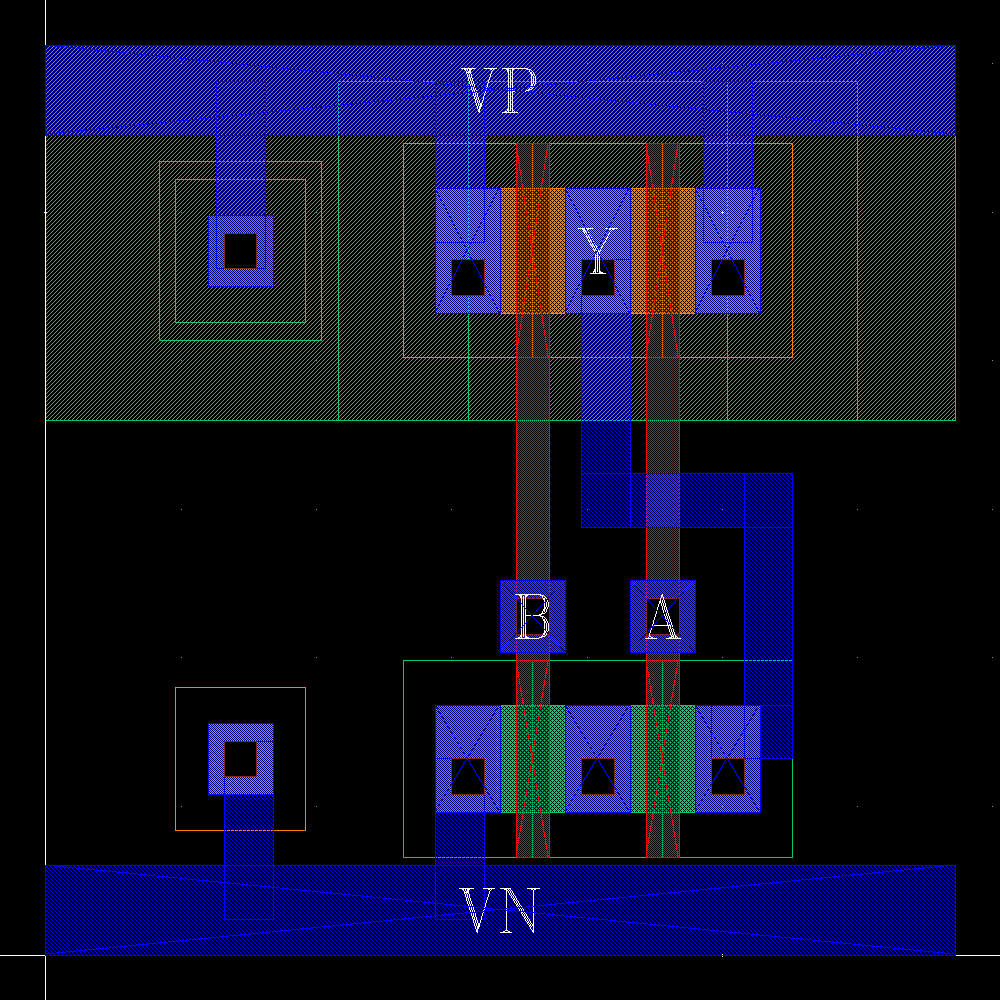
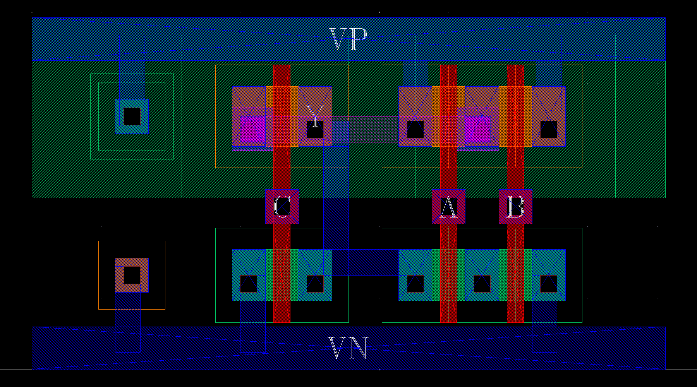
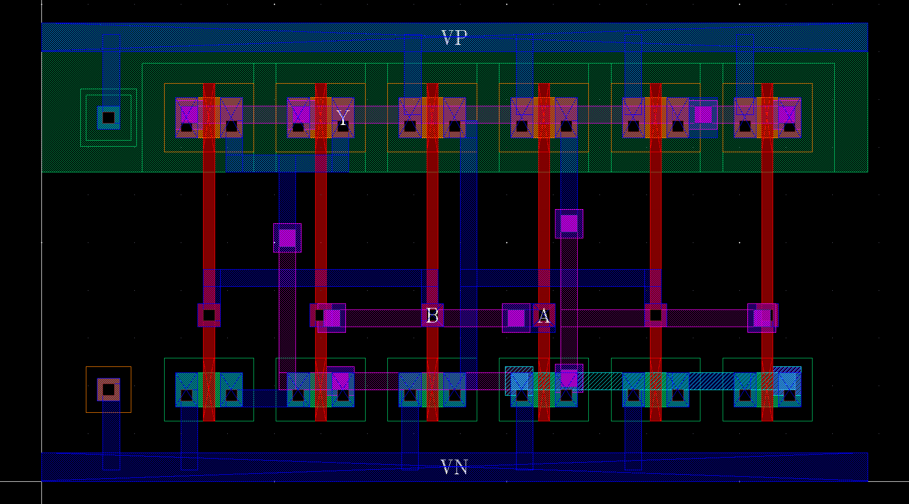

# cadence-auto-layout-hack

Experimental CMOS layout synthesis for licensed Cadence Virtuoso, with a SKILL placement and routing engine and a thin Python CLI. It reads schematic connectivity, instantiates installed MOS PCells, searches mirrored diffusion-sharing orders, routes actual metal and vias, creates physical pins and terminal-name displays, and runs Diva DRC, extraction and LVS.

**Development preview, not production-ready.** See [tested results](docs/BENCHMARKS.md) and [limitations](docs/LIMITATIONS.md). An output is usable only after its own native verification passes. The previous application-specific layouts are not evidence that this new engine supports hierarchy.

## Scope

The initial adapter targets NCSU CDK 1.6.0 / `NCSU_TechLib_tsmc03d`. Integration is tested with Virtuoso IC6.1.8 on Linux and Python 3.6.8. Public tests also run without Cadence.

Current input: flat static CMOS schematics composed of configured NMOS/PMOS symbols, explicit scalar terminals, positive numeric micron dimensions, one body supply per polarity, multiplicity 1–8, and nf=1. Both body supplies must be external terminals. Names are discovered; circuit names and coordinates are not hardcoded. Unsupported devices, vector terminals, mixed hierarchy, and recursive hierarchy produce errors.

Physical synthesis of hierarchical cells, folding, analog design, timing closure, and a global area optimum are **not implemented**.

## Layout examples

Actual Virtuoso exports of the project's original test fixtures. Each pictured
candidate completed native Diva extraction, passed DRC with zero violations, and
matched its source schematic in LVS. These are examples, not a claim of a global
area optimum; new outputs require their own verification.

### Short routes before seed variation

Both NAND2 candidates use placement seed 0 and measure **6.72 × 6.12 µm**
(**41.1264 µm²**). Both now use 8.34 micrometers of routed wire and zero new routing vias. Seeds may select equally good alternatives; they do not earn a reward for different geometry.

| Routing seed 17 | Routing seed 18 |
| --- | --- |
|  |  |

### AOI21

**9.12 × 4.92 µm**, area **44.8704 µm²**.



### XOR2

**17.76 × 9.60 µm**, area **170.496 µm²**.



See [image provenance](docs/images/README.md), [benchmarks](docs/BENCHMARKS.md),
[routing-quality comparison](docs/ROUTING_QUALITY.md), and [seed reproducibility results](docs/SEEDS.md).

## Install

Cadence, its licenses, and the NCSU/TSMC PDK are separate dependencies and are not distributed here. Do not copy them into this repository.

```sh
git clone https://github.com/ahnaj/cadence-auto-layout-hack.git
cd cadence-auto-layout-hack
# First source your site's Cadence/CDK environment.
./install.sh /absolute/path/to/your/cds.lib
```

The installer preserves existing local configuration, checks the installed libraries and decks using a native batch process, and writes only under this repository. Set the null constraints in `.local/config.json` from your installed rules before generating. There are deliberately no bundled proprietary rule values. See [installation](docs/INSTALL.md) and [adapter configuration](docs/TECHNOLOGY_ADAPTERS.md).

## Use

Global options precede the subcommand:

```sh
bin/autolayout --cds-lib /path/to/cds.lib doctor
bin/autolayout --cds-lib /path/to/cds.lib generate \
  --source-lib MY_CIRCUITS --cell custom_gate --output-lib MY_AUTO --dry-run
bin/autolayout --cds-lib /path/to/cds.lib generate \
  --source-lib MY_CIRCUITS --cell custom_gate --output-lib MY_AUTO \
  --optimize area --iterations 4
bin/autolayout --cds-lib /path/to/cds.lib generate \
  --source-lib MY_CIRCUITS --cell custom_gate --output-lib MY_ROW \
  --optimize fixed --height 6.12 --iterations 4
bin/autolayout report /path/to/run/summary.json
```

### Reproducible routing seeds

Omitting --seed chooses a fresh random routing seed and records it in the report. Use a positive explicit seed to repeat a run. Hold placement fixed to explore different routes at the same dimensions:

```sh
bin/autolayout --cds-lib /path/to/cds.lib generate \
  --source-lib MY_CIRCUITS --cell custom_gate --output-lib MY_ROUTES \
  --height 6.12 --optimize fixed --placement-seed 0 --seed 17 --iterations 4
```

This tries routing seeds 17, 18, 19 and 20 with the same placement and height. Without --placement-seed, the existing placement search advances its ordering index for each candidate. Re-run an individual candidate with its recorded placement_seed and routing_seed.

Reports include both seeds, geometry/routing fingerprints and all verified equal-area alternatives. Different seeds can converge to the same route or fail; native DRC/LVS remains mandatory. Seed 0 disables random tie breaking. Verified candidates rank by area, routed wire length, via count and bends; different seeds are allowed to converge on the same route. See [seed regression evidence](docs/SEEDS.md).

Each run receives a fresh directory and private `cds.lib` which includes your source library definitions. Candidate libraries are named `MY_AUTO_c00`, etc. for multiple iterations. The summary identifies the smallest **verified** candidate. Failed candidates and real logs remain for diagnosis; no candidate is silently promoted.

Open Virtuoso with the reported `cds_lib` path, then open the reported library/cell/layout in Library Manager. Existing global library registration is not edited. Use `envSetVal("layout" "displayPinNames" 'boolean t)` in the CIW to show terminal-associated pin names.

For re-verification, use that run's `cds.lib` and supply the golden schematic:

```sh
bin/autolayout --cds-lib /path/to/run/cds.lib verify \
  --lib MY_AUTO_c00 --cell custom_gate --source-lib MY_CIRCUITS
```

See [quick start](docs/QUICKSTART.md), [verification](docs/VERIFICATION.md), [architecture](docs/ARCHITECTURE.md), and [troubleshooting](docs/TROUBLESHOOTING.md).

## Safety and tests

Source schematics open read-only. Generation requires a fresh output library and directory. There is no overwrite switch. Dry-run reads and validates input without writing a design database; it still saves private process logs. Only the batch wrapper exits Virtuoso. Loading the modules interactively does not.

```sh
python3 -m unittest discover -s tests -v
python3 -m compileall -q scripts
sh -n install.sh bin/autolayout
```

These tests validate orchestration and status parsing, not physical signoff. Native regression fixtures are in `examples/fixtures.il`; their layouts are synthesized from connectivity. See [benchmarks](docs/BENCHMARKS.md) for the reproduction procedure and actual coverage.

Newly authored code is MIT licensed. See [provenance](docs/PROVENANCE.md). No remote repository is configured or published by the installer.
